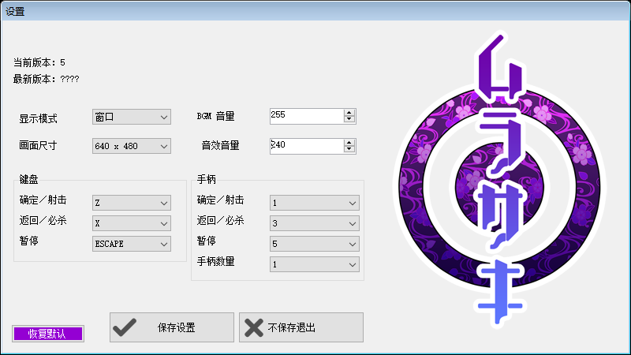
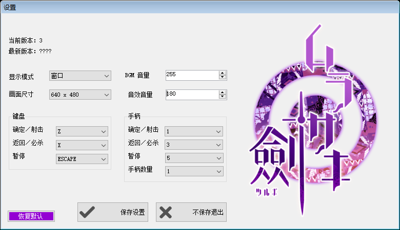

# Murasaki 双作简体中文汉化补丁

《[Murasaki](https://store.steampowered.com/app/392030/)》(紫)与《[Murasaki Tsurugi](https://store.steampowered.com/app/865060/)》(ムラサキ劍)两款游戏的全文本简体中文汉化补丁,含设置程序 `config.exe` 的完整汉化。





- **状态**:完成并验证(游戏内全部文本 + 两作 config.exe 界面)
- **测试环境**:Windows 10 x64、Steam 版 Murasaki(patch 5)/ Murasaki Tsurugi(patch 3)
- **游戏本体**:© Katatema(てつ),DX Library 制作。本补丁为非官方同人作品,请通过 Steam 等正规渠道获取游戏。

## 下载安装

从 [Releases](../../releases) 下载 `Murasaki-CN-Patch-vX.Y.zip` 并解压,然后:

| 游戏 | 操作 |
|------|------|
| Murasaki | 把压缩包内 `Murasaki` 文件夹的**全部内容**解压到游戏目录(与 `mu.exe` 同级,形如 `C:\Program Files (x86)\Steam\steamapps\common\Murasaki\Murasaki\`),选择覆盖 |
| Murasaki Tsurugi | 把 `Murasaki2` 文件夹的内容解压到 `...\steamapps\common\Murasaki2\Murasaki2\`,选择覆盖 |

游戏目录可在 Steam 中右键游戏 → 管理 → 浏览本地文件找到(注意两款游戏目录都是双层嵌套,要进到有 `mu.exe` 的内层)。

解压覆盖后直接运行游戏即为中文;`config.exe` 设置程序同样已汉化(窗口标题「设置」、全部标签/按钮/下拉框、错误提示)。

**还原原版**:Steam 右键游戏 → 属性 → 已安装文件 → 验证游戏文件完整性。

压缩包内每作只有 5 个被修改的文件:

```
Murasaki/                    Murasaki2/
  config.exe                   config.exe
  lang.dat                     lang.dat
  data/config.txt              data/config.txt
  data/txt.dat                 data/txt.dat
  patch/5/data/txt.dat         patch/3/data/txt.dat
```

## 从源码构建

本仓库本身**不含任何游戏数据**,翻译以文本源码形式存放,可从你自己的游戏原版文件完整重建出上述补丁(构建产物与 Release 中发布的文件逐字节一致,已验证):

```bash
git clone https://github.com/Cyclin15/murasaki-cn.git
cd murasaki-cn/tools

# 构建(默认游戏目录为 ../Murasaki 与 ../Murasaki2/Murasaki2,可用环境变量覆盖)
python build_m1.py                  # 或 MURASAKI1_DIR=<游戏1目录> python build_m1.py
python build_m2.py                  # 或 MURASAKI2_DIR=<游戏2目录> python build_m2.py

# 安装到游戏目录(复制 .dat、原位修补 config.exe、写入中文 config.txt)
python install.py --m1 <游戏1目录> --m2 <游戏2目录>
```

仅需 Python 3 标准库,无第三方依赖。

## 目录结构

```
cn/          翻译源码:m1_*.txt / m2_*.txt,与档案内同名文本文件一一对应,
             每行 "key<TAB>[引擎标记]译文"
tools/       构建与安装脚本
  dxa.py         DX 档案读取(异或解密 + LZSS 解压)
  dxa_write.py   DX 档案重建
  build_patch.py 翻译合并核心(按 key 替换、保留 [speed:6.8] 等引擎标记)
  build_m1.py    构建第一作 lang.dat / txt.dat
  build_m2.py    构建第二作 lang.dat / txt.dat / patch/3 层
  install.py     一键安装(.dat 覆盖 + config.exe 原位修补 + config.txt)
config_txt/  两作设置程序界面文本(UTF-8 BOM)
verification/ 运行时验证工具(见其中 README)
screenshots/ 截图
```

## 技术说明

**文本档案(DX Library DX 打包档)**:两款游戏的文本分布在三层,均已替换 —— 原文层 `data/txt.dat`(日文)、语言层 `lang.dat`(英文,优先级更高)、版本补丁层 `patch/<版本>/data/txt.dat`。档案自带异或加密与 LZSS 压缩;每条文本为 `key\tvalue` 行,`[...]` 前缀是引擎标记(播放速度、字号、点击等待等),替换时保留原标记只换正文。文本编码遵循原文件自身约定(ASCII / CP932 / UTF-16),中文超出 CP932 时自动升级为 UTF-16LE + BOM(引擎原生支持)。

**config.exe(.NET 2.0 WinForms)**:界面文本不在 exe 内,而是外置的 `data/config.txt` 键值表(UTF-8 BOM + CRLF);exe 内仅窗口标题与几条错误信息,存于 #US 字符串堆。对 #US 采用**等长原位修补**:新串不长于旧串,重写长度前缀与数据、尾部清零作死区,其他字符串偏移不受影响,文件大小不变。第二作的版本行由代码以 `{0}:{1}` 格式拼接,补丁将该格式串冒号改为全角,避免与标签冒号叠加成双冒号。

**验证方法**:详见 [verification/README.md](verification/README.md)。要点:通过 `GetGlyphOutlineW` 钩子记录游戏运行时实际栅格化的全部码点,确认每个译文汉字都被引擎渲染(两作均零缺字);config.exe 在独立桌面上启动,枚举全部控件文本与下拉框条目,并用 PrintWindow 截图做像素级检查,确认无豆腐块。

## 版权与许可

- 游戏本体 © Katatema。本补丁为非官方同人作品,不附带、不替代游戏本体,请在持有正版的前提下使用。
- 代码(tools/、verification/)以 [MIT License](LICENSE) 发布。
- 翻译文本(cn/)以 [CC BY-NC 4.0](https://creativecommons.org/licenses/by-nc/4.0/) 发布。
